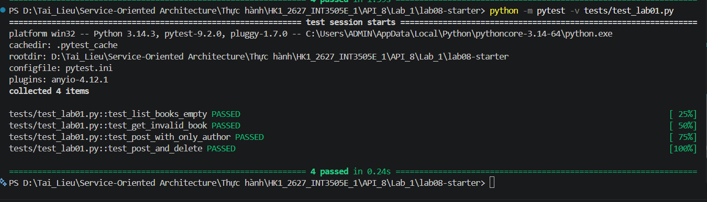
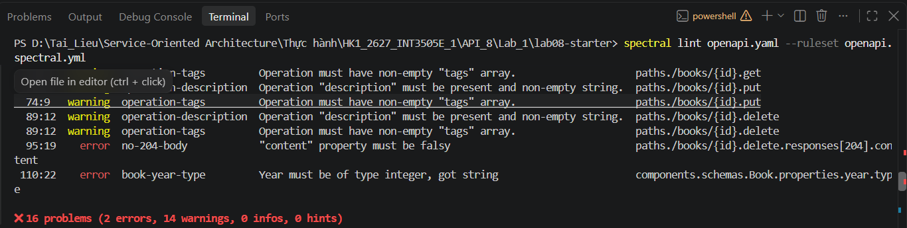
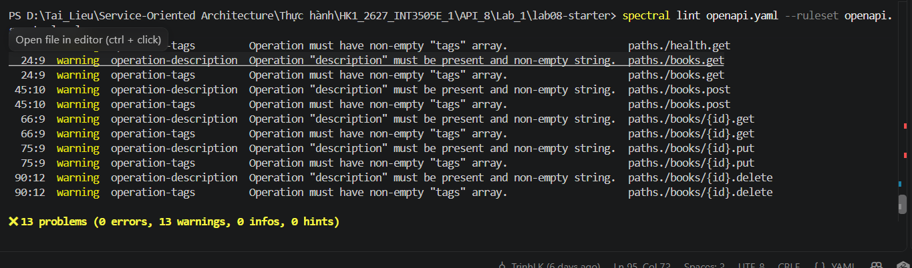
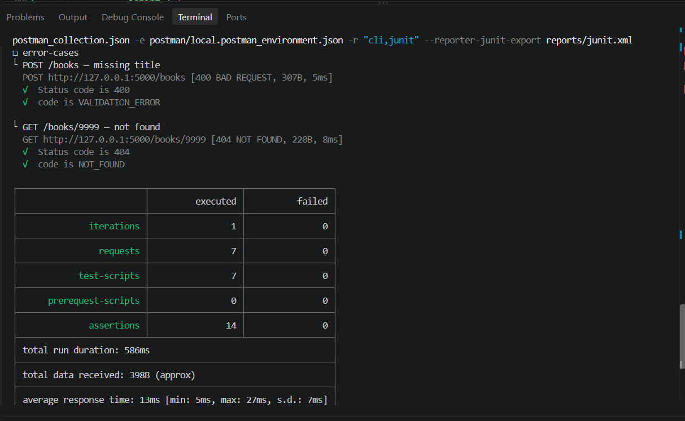

## Lab 1 — pytest

### Yêu cầu
Viết các test trong [tests/test_lab01.py](tests/test_lab01.py), mỗi test dùng DB riêng và không phụ thuộc thứ tự chạy.

### Các test đã viết

| Test | Kịch bản | Kỳ vọng |
|---|---|---|
| `test_list_books_empty` | `GET /books` khi DB rỗng | HTTP 200, body `[]` |
| `test_get_invalid_book` | `GET /books/9999` | HTTP 404, `code == "NOT_FOUND"` |
| `test_post_with_only_author` | `POST /books` chỉ có `author` | HTTP 400, `errors` chứa field `title` |
| `test_post_and_delete` | Tạo sách → xóa → `GET` lại cùng id | 201 → 204 → 404 (`NOT_FOUND`) |

### Lệnh chạy
```bash
python -m pytest -v tests/test_lab01.py
```

### Kết quả
Cả 4 test đều **PASSED** trong 0.24s.



---

## Lab 2 — OpenAPI / Spectral

### Yêu cầu
File `openapi.yaml` có 3 lỗi cố ý. Dùng Spectral để phát hiện và sửa.

### Lệnh chạy
```bash
spectral lint openapi.yaml --ruleset openapi.spectral.yml
```

### Trước khi sửa
Spectral báo **16 problems (2 errors, 14 warnings)**, trong đó 2 lỗi error do custom rule phát hiện:
- `no-204-body`: response 204 của `DELETE /books/{id}` có `content`.
- `book-year-type`: `Book.year` khai báo kiểu `string`.

Ngoài ra, `GET /books` thiếu `operationId` (rule `operation-operationId` của `spectral:oas`, mức warning).



### Các lỗi đã sửa

| # | Lỗi | Cách sửa |
|---|---|---|
| 1 | `GET /books` thiếu `operationId` | Thêm `operationId: listBook` |
| 2 | Response `204` của `DELETE /books/{id}` có `content` | Xóa phần `content`, chỉ giữ `description` |
| 3 | `Book.year` có `type: string` | Đổi thành `type: integer, nullable: true` (khớp model Python) |

```yaml
# Sau khi sửa
/books:
  get:
    operationId: listBook
...
delete:
  operationId: deleteBook
  responses:
    '204':
      description: Deleted (response has no body)
...
year: {type: integer, nullable: true}
```

### Sau khi sửa
Còn lại **13 problems (0 errors, 13 warnings)**. Các lỗi error đã hết, warning về `operationId` cũng không còn. 13 warning còn lại chỉ là `operation-description` và `operation-tags` (thiếu mô tả/tags), không ảnh hưởng đến tính đúng của contract.



> **Ghi chú:** Spectral chỉ kiểm tra cú pháp và quy tắc của spec, không đối chiếu với code Flask. Vì vậy cần kết hợp pytest + jsonschema để kiểm chứng response thực tế.

---

## Lab 3 — Postman / Newman

### Yêu cầu
- Tạo folder `error-cases/` gồm `POST /books` thiếu `title` và `GET /books/9999`.
- Mỗi error request có ít nhất 2 `pm.test` (HTTP status + JSON `code`).
- Chạy bằng Newman và xuất JUnit report.

### Các test case bổ sung

| Request | Test 1 | Test 2 |
|---|---|---|
| `POST /books` — missing title | Status code is 400 | `code` is `VALIDATION_ERROR` |
| `GET /books/9999` — not found | Status code is 404 | `code` is `NOT_FOUND` |

### Lệnh chạy
```bash
newman run books-api.postman_collection.json \
  -e postman/local.postman_environment.json \
  -r cli,junit --reporter-junit-export reports/junit.xml
```

### Kết quả

| | executed | failed |
|---|---:|---:|
| iterations | 1 | 0 |
| requests | 7 | 0 |
| test-scripts | 7 | 0 |
| assertions | 14 | 0 |

- Tổng thời gian chạy: **586ms**
- Thời gian phản hồi trung bình: **13ms** (min 5ms, max 27ms)



JUnit report được lưu tại [reports/junit.xml](reports/junit.xml), gồm 5 happy-path requests (list → create → get → update → delete) và 2 error-cases, tất cả đều `failures="0"`.

---

